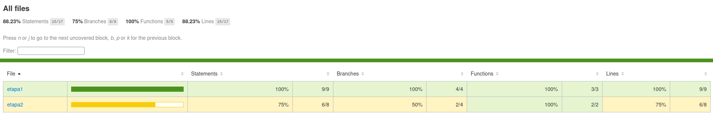
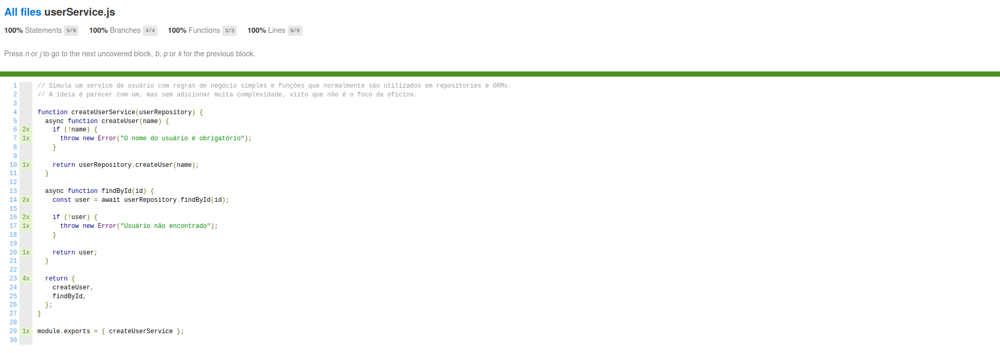
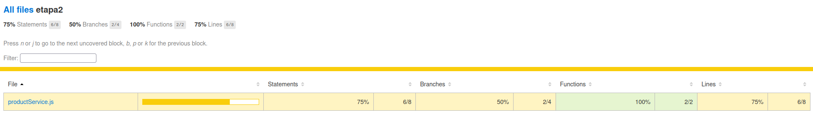

# Testes Unitários com Jest

#### Objetivo dessa branch

A branch `02-unit-test` da oficina de testes com Jest é dividida em duas etapas:

1. A primeira etapa te mostrará alguns exemplos simulando testes unitários e explicará como configurar a cobertura de testes (`coverage`).
2. Nesta etapa, você colocará em prática os conceitos apresentados anteriormente, completando os testes unitários do serviço `productService.js`.

> [!IMPORTANT]
>
> O Jest executa sobre o Node.js. Portanto, você precisa ter o Node.js e o npm instalados para executar os exemplos. Para isso, basta acessar a [plataforma oficial do Node.js](https://nodejs.org/pt-br) e seguir os comandos para sua instalação de acordo com a sua máquina.
>
> Confirme com:
> `node -v` e `npm -v` no terminal

## 1ª Etapa — Exemplificando Testes Unitários com Jest

Aqui o Jest já está implementado e configurado, pronto para rodarmos nossos exemplos de testes unitários:

```bash
npm run test -- user-service.unit.spec.js
```

Os exemplos de testes unitários estão localizados em `src/etapa1/`.

O arquivo `userService.js` implementa um serviço com regras de negócio simples, enquanto `user-service.unit.spec.js` contém os testes que verificam seus comportamentos, incluindo cenários de sucesso e de erro.

Para compreender os métodos do Jest utilizados nos exemplos, consulte o arquivo `src/etapa1/JEST_CHEATSHEET.md`.

### Vamos analisar a saída

```bash
$ npm run test -- user-service.unit.spec.js

> test
> jest user-service.unit.spec.js

 PASS  src/etapa1/user-service.unit.spec.js
  UserService
    createUser
      ✓ should create a user when the name is valid (9 ms)
      ✓ should throw an error when the name is not provided (7 ms)
    findById
      ✓ should return a user when found (2 ms)
      ✓ should throw an error when the user is not found (2 ms)

Test Suites: 1 passed, 1 total
Tests:       4 passed, 4 total
Snapshots:   0 total
Time:        0.77 s, estimated 2 s
Ran all test suites matching user-service.unit.spec.js.
```

Perceba que todos os testes passaram e com um detalhe diferente do que vimos anteriormente:

```js
// user-service.unit.spec.js

let userRepository;
let userService;

beforeEach(() => {
  userRepository = {
    createUser: jest.fn().mockResolvedValue({
      id: 1,
      name: "Gabriel",
    }),
    findById: jest.fn().mockResolvedValue({
      id: 1,
      name: "Gabriel",
    }),
  };

  userService = createUserService(userRepository);
});
```

O `beforeEach(() => {...})` executa sua função antes de cada teste do grupo em que está definido.

Nesse caso, ele cria um repositório simulado com comportamentos predefinidos e injeta essa dependência no `userService`. Assim, cada teste começa com uma nova instância do mock, evitando que alterações feitas em um cenário interfiram nos demais.

Dessa forma conseguimos verificar se o retorno esperado equivale ao retorno do método em si:

```js
// user-service.unit.spec.js

// ...

const result = await userService.createUser("Gabriel");

expect(result).toEqual({
  id: 1,
  name: "Gabriel",
});

// ...
```

> [!NOTE]
>
> Recomendamos também a leitura dos comentários presentes em `user-service.unit.spec.js`, que explicam a implementação dos testes.

### Configurando a cobertura dos testes (`coverage`)

Para finalizar essa etapa vamos fazer a configuração do `coverage`, basta seguir os passos:

1. Criando arquivo de configuração do Jest:

> Crie um arquivo com o nome `jest.config.js` na raíz do projeto.

2. Adicione:

```js
// jest.config.js

const config = {
  collectCoverageFrom: ["src/**/*.js"], // Define quais arquivos serão considerados na cobertura
  coverageDirectory: "coverage", // Define o diretório onde os relatórios serão salvos.
};

module.exports = config;
```

3. Agora vamos criar um comando para rodarmos a cobertura de testes:

Adicione o script no `package.json`:

```json
// package.json

"test:coverage": "jest --coverage"
```

Ele deve ficar assim no final:

```json
// package.json

{
  "devDependencies": {
    "jest": "^30.5.2"
  },
  "scripts": {
    "test": "jest",
    "test:coverage": "jest --coverage"
  }
}
```

4. Rode o comando:

```bash
npm run test:coverage
```

### Vamos entender a saída

```bash
$ npm run test:coverage

> test:coverage
> jest --coverage

 PASS  src/etapa1/user-service.unit.spec.js
  UserService
    createUser
      ✓ deve criar um usuário quando o nome for válido (10 ms)
      ✓ deve lançar um erro quando o nome não for informado (5 ms)
    findById
      ✓ deve retornar um usuário quando ele for encontrado (2 ms)
      ✓ deve lançar um erro quando o usuário não for encontrado (1 ms)

----------------|---------|----------|---------|---------|-------------------
File            | % Stmts | % Branch | % Funcs | % Lines | Uncovered Line #s
----------------|---------|----------|---------|---------|-------------------
All files       |     100 |      100 |     100 |     100 |
 userService.js |     100 |      100 |     100 |     100 |
----------------|---------|----------|---------|---------|-------------------
Test Suites: 1 passed, 1 total
Tests:       4 passed, 4 total
Snapshots:   0 total
Time:        1.35 s
```

Perceba que ele cobriu as linhas de todos os arquivos que encontrou e nos devolveu as métricas onde:

- **Stmts (Statements)**: percentual de instruções executadas durante os testes.
- **Branch**: percentual de caminhos possíveis nas estruturas condicionais que foram exercitados, como os resultados verdadeiro e falso de um if
- **Funcs (Functions)**: percentual de funções que foram chamadas durante os testes.
- **Lines**: percentual de linhas executáveis que foram executadas durante os testes.
- **Uncovered Line #s**: números das linhas executáveis que não foram cobertas pelos testes.

Vale explicar também que esses indicadores medem aspectos diferentes da cobertura. Executar uma linha não significa necessariamente verificar se seu comportamento está correto.

#### Além disso, ele também cria uma pasta onde você pode visualizar no navegador as métricas:

```bash
coverage
├── clover.xml
├── coverage-final.json
├── lcov.info
└── lcov-report
    ├── base.css
    ├── block-navigation.js
    ├── favicon.png
    ├── index.html
    ├── prettify.css
    ├── prettify.js
    ├── sort-arrow-sprite.png
    ├── sorter.js
    └── userService.js.html
```

Para visualizarmos as métricas, basta abrir o `index.html`:

- Página inicial do `index.html`:
  

- Cobertura do nosso arquivo `userService.js`:
  

## 2ª Etapa — Criando meu primeiro Teste Unitário com Jest

Nesta etapa, você encontrará o serviço `productService.js` e uma estrutura inicial de testes no arquivo `product-service.unit.spec.js`.

Seu desafio é completar as asserções indicadas pelos comentários `TODO`, verificando os resultados esperados e as interações com o repositório simulado.

Ao finalizar, execute os testes e gere novamente o relatório de cobertura. O objetivo é alcançar 100% em todas as métricas de cobertura do arquivo `productService.js`, garantindo também que os testes verifiquem corretamente os comportamentos esperados.

### ⚠️ ATENÇÃO

Se você executar `npm run test` neste momento, verá que todos os testes passam, mesmo sem as asserções solicitadas no exercício:

```bash
$ npm run test

> test
> jest

 PASS  src/etapa2/product-service.unit.spec.js
 PASS  src/etapa1/user-service.unit.spec.js

Test Suites: 2 passed, 2 total
Tests:       7 passed, 7 total
Snapshots:   0 total
Time:        0.73 s, estimated 1 s
Ran all test suites.
```

Isso acontece porque o Jest considera um teste aprovado quando sua execução termina sem falhas e nenhuma asserção falha. Como ainda não adicionamos as asserções indicadas pelos comentários `TODO`, os testes podem passar sem verificar se o serviço apresenta o comportamento esperado.

#### Analisando a cobertura

Agora, execute o comando `npm run test:coverage` para gerar o relatório de cobertura dos testes.

Observe o resultado:

```bash
$ npm run test:coverage

...

--------------------|---------|----------|---------|---------|-------------------
File                | % Stmts | % Branch | % Funcs | % Lines | Uncovered Line #s
--------------------|---------|----------|---------|---------|-------------------
All files           |   88.23 |       75 |     100 |   88.23 |
 etapa1             |     100 |      100 |     100 |     100 |
  userService.js    |     100 |      100 |     100 |     100 |
 etapa2             |      75 |       50 |     100 |      75 |
  productService.js |      75 |       50 |     100 |      75 | 7,13
--------------------|---------|----------|---------|---------|-------------------
```

Perceba que, embora todos os testes tenham passado, o arquivo `productService.js` ainda não atingiu 100% de cobertura. O relatório indica que algumas instruções e ramificações do código ainda não foram executadas.

A imagem a seguir mostra o relatório de cobertura gerado nesse cenário:



#### Seu desafio

Complete as asserções indicadas pelos comentários `TODO` em `src/etapa2/product-service.unit.spec.js`.

Depois, execute novamente os testes e gere um novo relatório de cobertura para verificar os resultados.

> Considere o exercício concluído quando todas as métricas de cobertura do arquivo `productService.js` atingirem 100% e todos os testes passarem.

**Atenção:** atingir 100% de cobertura não garante, por si só, que os testes estejam corretos ou que todos os comportamentos importantes tenham sido validados. Além de observar as métricas, verifique se as asserções realmente conferem os resultados e comportamentos esperados.

#### Se estiver com dificuldade para resolver o exercício, acesse a colinha `src/etapa2/COLINHA.md`

## Autores

|                                                                                                                         |                                                                                                                                |                                                                                                                                     |
| :---------------------------------------------------------------------------------------------------------------------: | :----------------------------------------------------------------------------------------------------------------------------: | :---------------------------------------------------------------------------------------------------------------------------------: |
|                                 |                                                 |                                                                |
|                                              **Gabriel Enzo (genzo-dev)**                                               |                                                        **Luis Felipe**                                                         |                                                             **Rangel**                                                              |
|                                           <sub>Fullstack web developer</sub>                                            |                                               <sub>Fullstack web developer</sub>                                               |                                                 <sub>Fullstack web developer</sub>                                                  |
| <a href="https://www.linkedin.com/in/genzo-dev/">💼 LinkedIn</a> · <a href="https://github.com/genzo-dev">🐙 GitHub</a> | <a href="https://www.linkedin.com/in/luisfelipe15/">💼 LinkedIn</a> · <a href="https://github.com/LuisF3L1P3dev">🐙 GitHub</a> | <a href="https://www.linkedin.com/in/rangel-rocha-779139228/">💼 LinkedIn</a> · <a href="https://github.com/rangelro">🐙 GitHub</a> |
